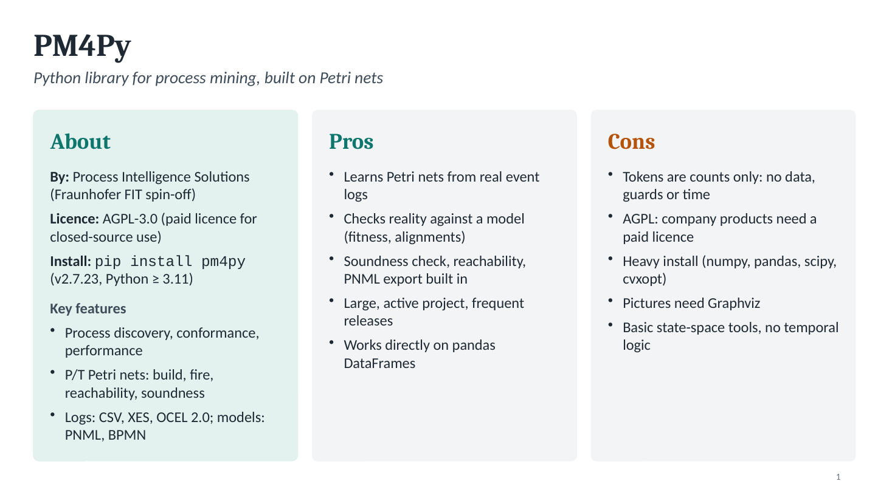
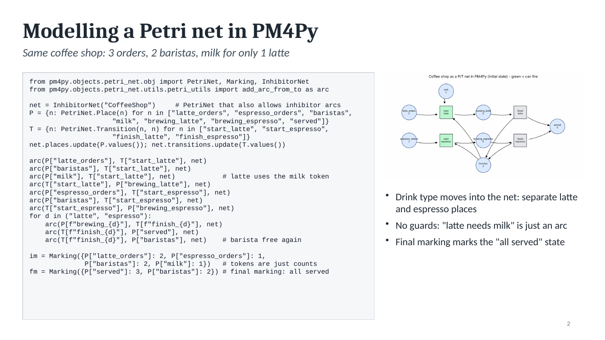
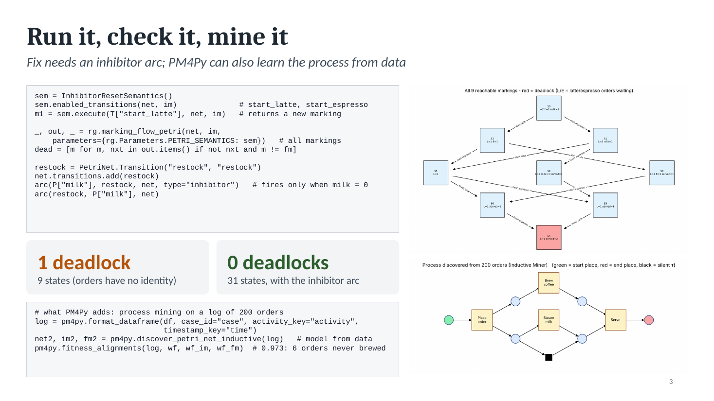

# PM4Py – Petri nets and process mining in Python (slides)

- `PM4Py_slides.pptx`: the 3 slides (download it from GitHub with the **Download raw file** button)
- `slides/`: a picture of each slide
- `images/`: the diagrams used on the slides
- `coffee_shop_pm4py.py`: full runnable example (`pip install pm4py`; prints 9 states / 1 deadlock, then 31 / 0)

The text of every slide is below, ready to copy.

---

## Slide 1 – PM4Py

*Python library for process mining, built on Petri nets*



**About**
- **By:** Process Intelligence Solutions (Fraunhofer FIT spin-off)
- **Licence:** AGPL-3.0 (paid licence for closed-source use)
- **Install:** `pip install pm4py` (v2.7.23, Python ≥ 3.11)
- **Key features**
  - Process discovery, conformance, performance
  - P/T Petri nets: build, fire, reachability, soundness
  - Logs: CSV, XES, OCEL 2.0; models: PNML, BPMN

**Pros**
- Learns Petri nets from real event logs
- Checks reality against a model (fitness, alignments)
- Soundness check, reachability, PNML export built in
- Large, active project, frequent releases
- Works directly on pandas DataFrames

**Cons**
- Tokens are counts only: no data, guards or time
- AGPL: company products need a paid licence
- Heavy install (numpy, pandas, scipy, cvxopt)
- Pictures need Graphviz
- Basic state-space tools, no temporal logic

---

## Slide 2 – Modelling a Petri net in PM4Py

*Same coffee shop: 3 orders, 2 baristas, milk for only 1 latte*



```python
from pm4py.objects.petri_net.obj import PetriNet, Marking, InhibitorNet
from pm4py.objects.petri_net.utils.petri_utils import add_arc_from_to as arc

net = InhibitorNet("CoffeeShop")     # PetriNet that also allows inhibitor arcs
P = {n: PetriNet.Place(n) for n in ["latte_orders", "espresso_orders", "baristas",
                     "milk", "brewing_latte", "brewing_espresso", "served"]}
T = {n: PetriNet.Transition(n, n) for n in ["start_latte", "start_espresso",
                     "finish_latte", "finish_espresso"]}
net.places.update(P.values()); net.transitions.update(T.values())

arc(P["latte_orders"], T["start_latte"], net)
arc(P["baristas"], T["start_latte"], net)
arc(P["milk"], T["start_latte"], net)            # latte uses the milk token
arc(T["start_latte"], P["brewing_latte"], net)
arc(P["espresso_orders"], T["start_espresso"], net)
arc(P["baristas"], T["start_espresso"], net)
arc(T["start_espresso"], P["brewing_espresso"], net)
for d in ("latte", "espresso"):
    arc(P[f"brewing_{d}"], T[f"finish_{d}"], net)
    arc(T[f"finish_{d}"], P["served"], net)
    arc(T[f"finish_{d}"], P["baristas"], net)    # barista free again

im = Marking({P["latte_orders"]: 2, P["espresso_orders"]: 1,
              P["baristas"]: 2, P["milk"]: 1})   # tokens are just counts
fm = Marking({P["served"]: 3, P["baristas"]: 2}) # final marking: all served
```

Picture: `images/pm4py_net.png`

- Drink type moves into the net: separate latte and espresso places
- No guards: "latte needs milk" is just an arc
- Final marking marks the "all served" state

---

## Slide 3 – Run it, check it, mine it

*Fix needs an inhibitor arc; PM4Py can also learn the process from data*



```python
sem = InhibitorResetSemantics()
sem.enabled_transitions(net, im)              # start_latte, start_espresso
m1 = sem.execute(T["start_latte"], net, im)   # returns a new marking

_, out, _ = rg.marking_flow_petri(net, im,
    parameters={rg.Parameters.PETRI_SEMANTICS: sem})   # all markings
dead = [m for m, nxt in out.items() if not nxt and m != fm]

restock = PetriNet.Transition("restock", "restock")
net.transitions.add(restock)
arc(P["milk"], restock, net, type="inhibitor")   # fires only when milk = 0
arc(restock, P["milk"], net)
```

- **1 deadlock**: 9 states (orders have no identity)
- **0 deadlocks**: 31 states, with the inhibitor arc

```python
# what PM4Py adds: process mining on a log of 200 orders
log = pm4py.format_dataframe(df, case_id="case", activity_key="activity",
                             timestamp_key="time")
net2, im2, fm2 = pm4py.discover_petri_net_inductive(log)   # model from data
pm4py.fitness_alignments(log, wf, wf_im, wf_fm)  # 0.973: 6 orders never brewed
```

Pictures: `images/pm4py_state_graph.png` (red = deadlock), `images/pm4py_discovered.png` (net learned from the log)
