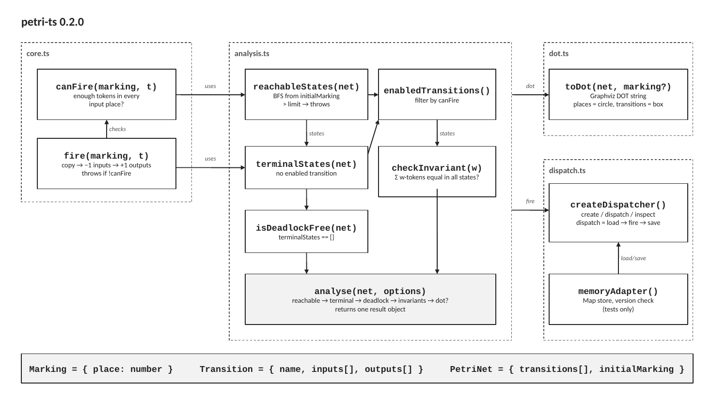

# petri-ts 0.2.0 — architecture (one slide)

- `petri_ts_slide.pptx` — the slide, all boxes and arrows are editable shapes (GitHub: **Download raw file**)
- `slide-1.png` — picture of the slide
- `verify_petri_ts.mjs` — runs every function once (`npm install petri-ts` then `node verify_petri_ts.mjs`)

## Text on the slide

**core.ts**
- `canFire(marking, t)` — enough tokens in every input place?
- `fire(marking, t)` — copy → −1 inputs → +1 outputs; throws if !canFire; checks canFire

**analysis.ts**
- `reachableStates(net)` — BFS from initialMarking; > limit → throws  (uses canFire, fire)
- `enabledTransitions()` — filter by canFire
- `terminalStates(net)` — no enabled transition  (← states)
- `checkInvariant(w)` — Σ w·tokens equal in all states?  (← states)
- `isDeadlockFree(net)` — terminalStates == []
- `analyse(net, options)` — reachable → terminal → deadlock → invariants → dot?; returns one result object

**dot.ts**
- `toDot(net, marking?)` — Graphviz DOT string; places = circle, transitions = box

**dispatch.ts**
- `createDispatcher()` — create / dispatch / inspect; dispatch = load → fire → save
- `memoryAdapter()` — Map store, version check (tests only); load/save

**Types**
`Marking = { place: number }`   `Transition = { name, inputs[], outputs[] }`   `PetriNet = { transitions[], initialMarking }`
